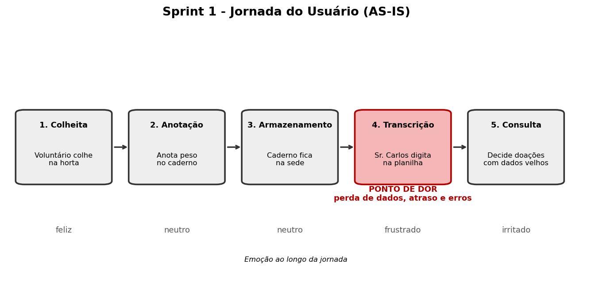

# 🌱 Sprint 1: Visão do Produto - AgroTech Monitor

**Disciplina:** Prototipagem de Sistemas Computacionais
**Professora:** Profa. Ma. Angela P. Barcellos
**Aluno:** Guilherme da Silva

## 1. Contexto

O Sr. Carlos administra hortas comunitárias e hoje controla colheitas, estoque e doações em papel e planilhas. O AgroTech Monitor digitaliza esse processo para reduzir perdas de dados e desperdício de alimentos.

## 2. Matriz de Stakeholders

| Stakeholder | Poder | Interesse | Estratégia | Expectativa |
| :--- | :---: | :---: | :--- | :--- |
| **Sr. Carlos (Gestor)** | Alto | Alto | Gerenciar de perto | Controle confiável de estoque e doações |
| **Voluntários** | Baixo | Alto | Manter informados | Registrar colheitas rápido pelo celular |
| **ONGs / Instituições** | Baixo | Médio | Monitorar | Receber doações com previsibilidade |
| **Comunidade local** | Baixo | Baixo | Monitorar | Acesso a alimentos de qualidade |
| **Prefeitura / Apoiadores** | Alto | Baixo | Manter satisfeitos | Relatórios de impacto social |

## 3. Backlog do Produto

### Requisitos Funcionais

| ID | Requisito | Prioridade |
| :--- | :--- | :---: |
| RF01 | Cadastrar e autenticar voluntários. | Alta |
| RF02 | Agendar colheitas por horta. | Média |
| RF03 | Registrar tipo e quantidade (kg) de alimento colhido. | Alta |
| RF04 | Registrar doações e vinculá-las às colheitas de origem. | Alta |
| RF05 | Gerar relatório mensal de colheitas e doações. | Média |

### Requisitos Não Funcionais

| ID | Categoria | Requisito |
| :--- | :--- | :--- |
| RNF01 | Usabilidade | Interface *mobile-first*, com botões grandes, para uso no campo. |
| RNF02 | Segurança | Dados dos voluntários protegidos conforme a LGPD. |
| RNF03 | Desempenho | Operações de registro em até 2 segundos. |

## 4. História de Usuário

> **Como** voluntário, **quero** registrar a colheita pelo celular, **para que** o Sr. Carlos saiba em tempo real o que há em estoque.

### Critérios de Aceite (BDD)

**Cenário 1: Registro com sucesso**
- **Dado que** estou autenticado e na tela "Registrar Colheita",
- **Quando** selecionar a horta e o alimento, informar a quantidade em kg e clicar em "Salvar",
- **Então** o sistema grava o registro, atualiza o estoque em tempo real e exibe "Colheita salva com sucesso".

**Cenário 2: Quantidade inválida**
- **Dado que** estou na tela "Registrar Colheita",
- **Quando** informar quantidade zero ou negativa e clicar em "Salvar",
- **Então** o sistema não grava e exibe "Informe uma quantidade maior que zero".

## 5. Mapa da Jornada do Usuário (AS-IS)

| Etapa | Ação | Ator | Ferramenta |
| :--- | :--- | :--- | :--- |
| 1. Colheita | Colhe os alimentos na horta | Voluntário | Balança e cestas |
| 2. Anotação | Anota tipo e peso no caderno | Voluntário | Caderno |
| 3. Armazenamento | Caderno fica na sede | Voluntário | Caderno físico |
| 4. Transcrição | Digita os dados na planilha | Sr. Carlos | Planilha |
| 5. Consulta | Decide as doações pela planilha | Sr. Carlos | Planilha |

> **⚠️ Ponto de dor (gargalo): etapa 4, transcrição manual.**
> Os dados chegam ao gestor dias depois, com risco de perda do caderno, letra ilegível e erros de digitação. Resultado: estoque desatualizado e desperdício de perecíveis.

**Oportunidade:** eliminar o papel e a digitação dupla, com registro digital no campo e estoque em tempo real.
