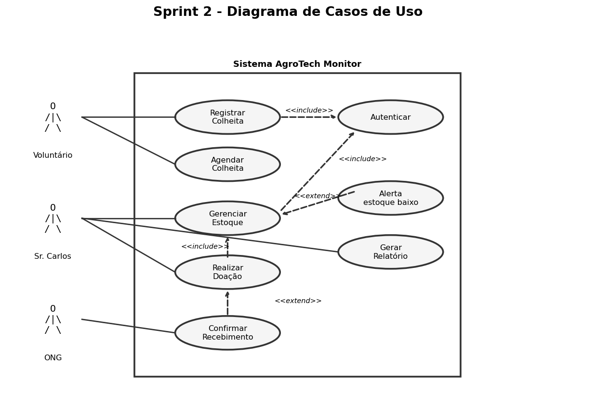
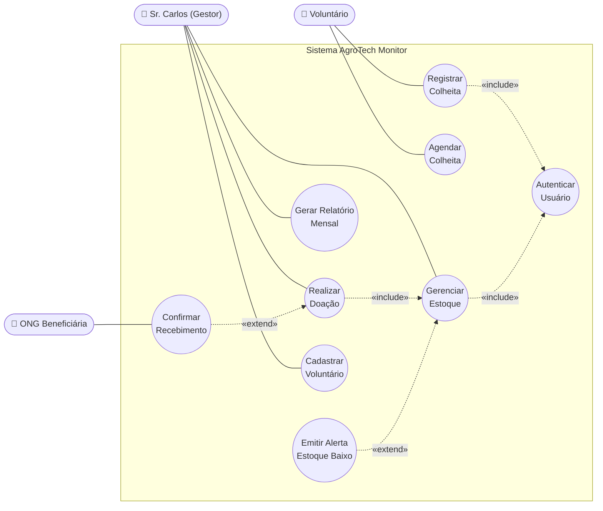
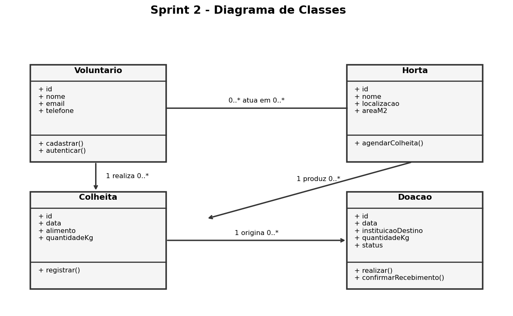
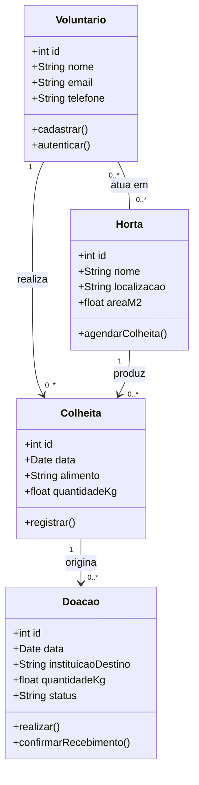
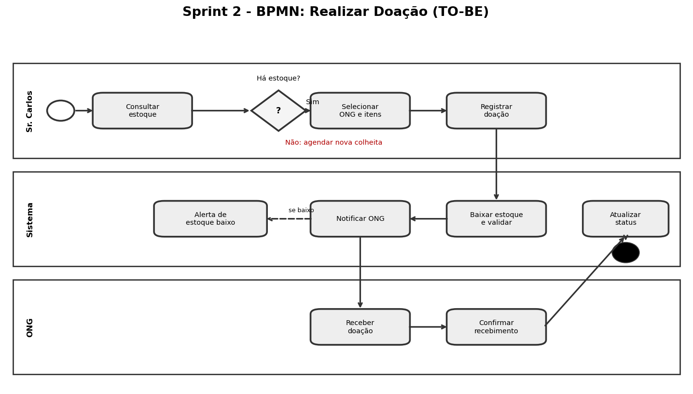
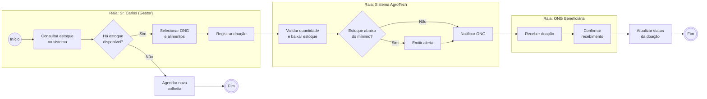

# 📐 Sprint 2: Diagramas UML e BPMN - AgroTech Monitor

**Disciplina:** Prototipagem de Sistemas Computacionais
**Professora:** Profa. Ma. Angela P. Barcellos
**Aluno:** Guilherme da Silva

## 1. Diagrama de Casos de Uso

> O Mermaid não tem tipo nativo de casos de uso, então usamos `flowchart`.

## 2. Diagrama de Classes

**Cardinalidades:** Voluntário→Colheita **1:N**; Horta→Colheita **1:N**; Voluntário↔Horta **N:N**; Colheita→Doação **1:N**.

## 3. Fluxo BPMN: Realizar Doação (TO-BE)

## 4. Especificação Textual: UC01 Registrar Colheita

| Campo | Descrição |
| :--- | :--- |
| **Ator principal** | Voluntário |
| **Objetivo** | Registrar tipo e quantidade de alimento colhido e atualizar o estoque. |
| **Pré-condições** | Voluntário autenticado; ao menos uma horta cadastrada. |
| **Pós-condições** | Colheita gravada e estoque atualizado. |
| **Requisitos** | RF03, RNF01, RNF03 |

**Fluxo Principal**
1. O voluntário acessa "Colheitas" e escolhe "Registrar Colheita".
2. O sistema exibe o formulário (horta, alimento, quantidade em kg).
3. O voluntário seleciona a horta.
4. O voluntário seleciona o alimento.
5. O voluntário informa a quantidade em kg.
6. O voluntário clica em "Salvar".
7. O sistema valida os dados.
8. O sistema grava a colheita e atualiza o estoque.
9. O sistema exibe "Colheita salva com sucesso" e encerra o caso de uso.

**Fluxos Alternativos**
- **A1: Registrar outra (passo 9).** O sistema limpa o formulário e volta ao passo 2.
- **A2: Cancelar (passos 2 a 6).** O sistema descarta os dados e volta à tela inicial.

**Fluxos de Exceção**
- **E1: Quantidade inválida (passo 7).** O sistema exibe "Informe uma quantidade maior que zero" e volta ao passo 5.
- **E2: Sessão expirada.** O sistema redireciona ao login e restaura o formulário após autenticar.
- **E3: Falha de conexão (passo 8).** O sistema guarda o registro localmente e sincroniza quando a conexão voltar.
