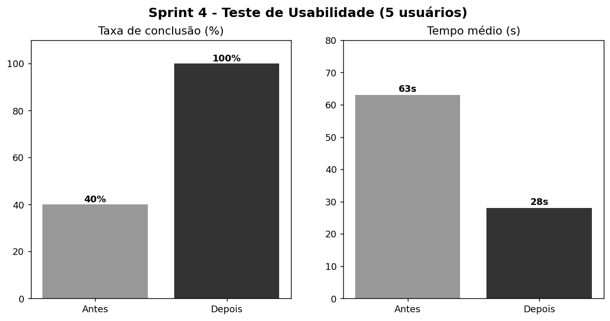

# 🏆 Sprint 4: Validação e Pitch - AgroTech Monitor

**Disciplina:** Prototipagem de Sistemas Computacionais
**Professora:** Profa. Ma. Angela P. Barcellos
**Aluno:** Guilherme da Silva

## 1. Relatório de Teste de Usabilidade

> Teste fictício, elaborado para fins acadêmicos.

| Item | Descrição |
| :--- | :--- |
| **Protótipo** | Wireframe mobile "Registrar Colheita" |
| **Participantes** | 5 usuários (3 voluntários, 1 gestor, 1 sem familiaridade com tecnologia) |
| **Tarefa** | Registrar 10 kg de tomate na Horta Centro |
| **Métricas** | Taxa de conclusão, tempo e erros |
| **Método** | Observação direta com *think aloud* |

### Resultados da 1ª rodada

| Usuário | Concluiu? | Tempo | Observação |
| :---: | :---: | :---: | :--- |
| U1 | ❌ | 1 min 10 s | Não encontrou o botão "Salvar". |
| U2 | ✅ | 48 s | Hesitou no menu inferior. |
| U3 | ❌ | 1 min 25 s | Não achou "Salvar" e confundiu os ícones. |
| U4 | ✅ | 40 s | Sem dificuldades. |
| U5 | ❌ | 1 min 30 s | Digitou "10" no campo errado e não viu o botão. |

**Taxa de conclusão:** 2/5 (40%)

### O que falhou
1. **Botão "Salvar" pouco visível:** 3 de 5 usuários não o localizaram.
2. **Baixo contraste no menu inferior**, ruim sob luz forte no campo.
3. **Rótulo pouco claro:** um usuário não entendeu que o campo era em quilos.
4. **Sem feedback de erro:** o formulário aceitava campos vazios.

### Correções aplicadas

| Problema | Correção |
| :--- | :--- |
| Botão pequeno | "Salvar" com 100% da largura e fonte de 18 px |
| Baixo contraste | Menu escurecido e aba ativa em negrito |
| Rótulo ambíguo | "Quantidade (kg)" com placeholder "Ex.: 10" |
| Sem validação | Alerta para campos vazios e quantidade menor ou igual a zero |

### Resultados da 2ª rodada

| Métrica | Antes | Depois |
| :--- | :---: | :---: |
| Taxa de conclusão | 40% | **100%** |
| Tempo médio | 1 min 03 s | **28 s** |
| Erros por usuário | 1,6 | **0,2** |

**Conclusão:** as correções eliminaram os bloqueios e atendem ao RNF01 (usabilidade) e ao RNF03 (desempenho).

---

## 2. Roteiro do Pitch Deck (3 slides)

### Slide 1: O Problema
**"40% das informações de colheita se perdem no papel."**
- O Sr. Carlos usa caderno e planilha.
- A digitação manual atrasa a informação e gera erros.
- Sem estoque confiável, perecíveis estragam antes de chegar a quem precisa.

*Fala (30 s):* "Imagine colher 100 kg de tomate e só descobrir dias depois que metade já estragou."

### Slide 2: A Solução
**"AgroTech Monitor: registre a colheita em 30 segundos, direto do celular."**
- App mobile-first com botões grandes.
- Estoque em tempo real, sem caderno e sem digitação dupla.
- Alertas de estoque baixo e registro de doações para ONGs.

*Fala (40 s):* "O voluntário escolhe a horta, o alimento, informa os quilos e salva. O gestor vê tudo na hora."

### Slide 3: O Valor de Negócio
**"Menos desperdício, mais transparência, mais impacto social."**

| Indicador | Meta |
| :--- | :--- |
| Desperdício de alimentos | **-20%** |
| Tempo de registro | de dias para **30 segundos** |
| Erros de transcrição | **próximo de zero** |
| Transparência | Relatório mensal automático |

*Fala (30 s):* "Cada quilo salvo vira prato na mesa de uma família."

**Próximo passo:** evoluir para um MVP com banco de dados e login de voluntários.
