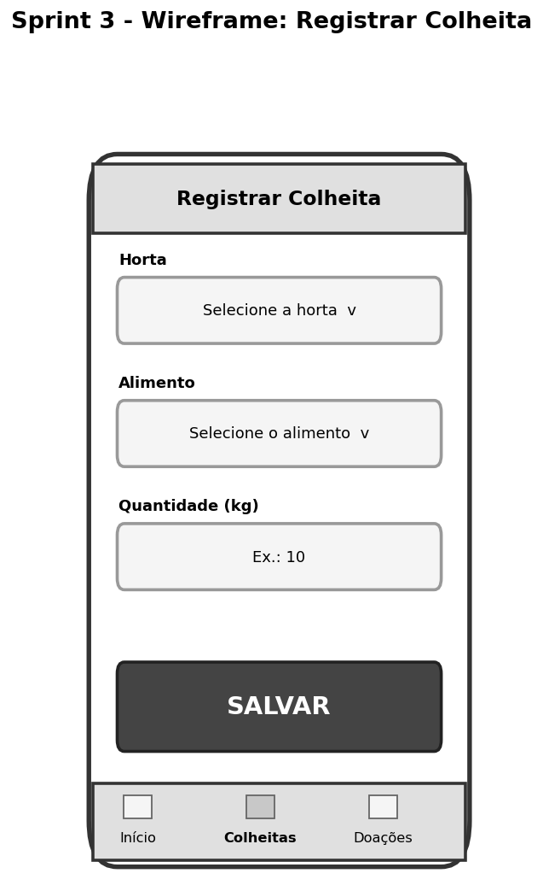

# 🚀 Prototipagem de Sistemas Computacionais

**Disciplina:** Prototipagem de Sistemas Computacionais
**Professora:** Profa. Ma. Angela P. Barcellos
**Aluno:** Guilherme da Silva

## 🌱 O projeto: AgroTech Monitor
Sistema fictício para gestão de **hortas comunitárias** administradas pelo Sr. Carlos. Hoje, colheitas, estoque e doações são anotados em papel e digitados depois em planilha, o que gera perda de dados e desperdício de alimentos. O AgroTech Monitor leva esse registro para o celular, no próprio campo.

## 📂 As 4 Sprints

| Sprint | Tema | Entregáveis | Link |
| :---: | :--- | :--- | :---: |
| 01 | O Desafio AgroTech (Kick-off) | Stakeholders, requisitos, BDD e jornada AS-IS | [Acessar](./01-sprint-kickoff/README.md) |
| 02 | A Planta Baixa do Sistema | Casos de uso, classes, BPMN e especificação textual | [Acessar](./02-sprint-plantabaixa/README.md) |
| 03 | Estrutura e Navegação (UX) | Wireframe mobile interativo | [Acessar](./03-sprint-wireframes/README.md) |
| 04 | Entrega Final do MVP | Teste de usabilidade e pitch | [Acessar](./04-sprint-mvp-validacao/README.md) |

## 🖼️ Prévia

## 🌐 Site do portfólio
A pasta `docs` na raiz do repositório contém o site (GitHub Pages), com todas as imagens e o wireframe funcionando.
