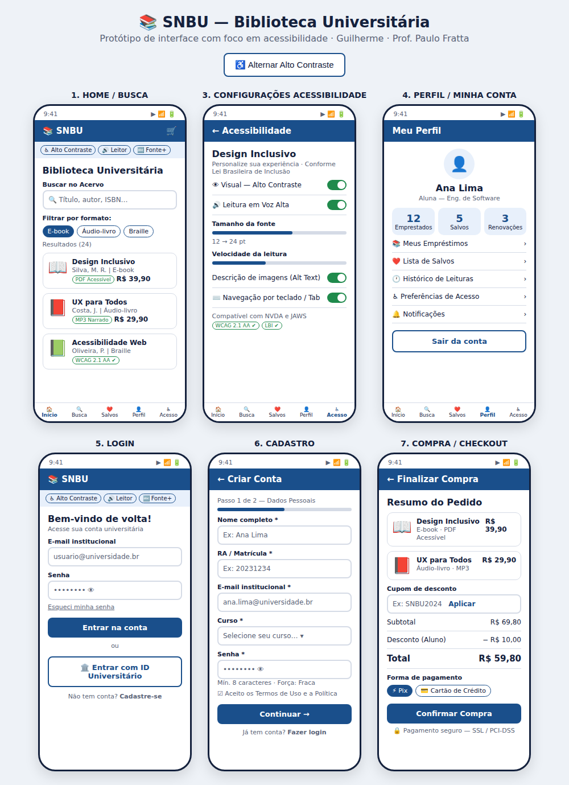
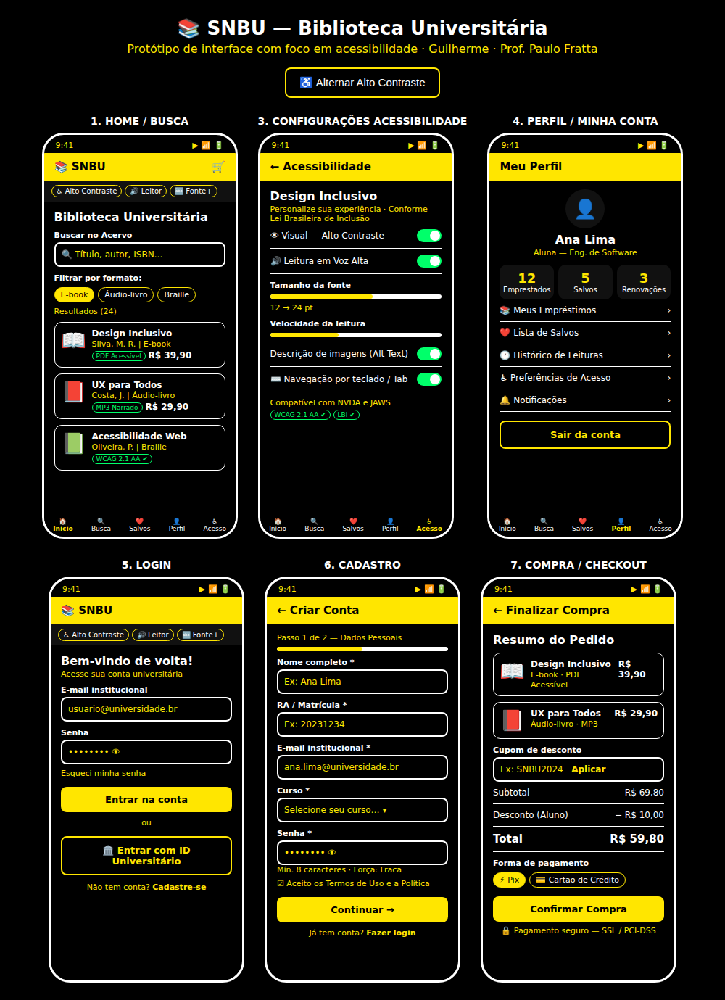

<div align="center">

# 🎨 Interface e Jornada do Usuário

### Meus trabalhos na disciplina do Prof. Paulo Fratta

**Por Guilherme**


[Trabalhos](#-meus-trabalhos) • [O que eu fiz](#-o-que-eu-desenvolvi) • [Habilidades](#-habilidades-praticadas) • [Contato](#-contato)

</div>

---

## 👋 Olá!

Sou o **Guilherme** e este é o registro dos trabalhos que desenvolvi na disciplina de **Interface e Jornada do Usuário**, orientada pelo **Prof. Paulo Fratta**.

O projeto é o **SNBU**, uma plataforma de biblioteca universitária pensada com **design inclusivo** (WCAG 2.1 AA e Lei Brasileira de Inclusão). Aqui mostro o caminho completo que percorri em cada projeto: entender o usuário, mapear a jornada, desenhar a interface e validar o resultado.

## 📝 Meus trabalhos

| Nº | Projeto | O que entreguei | Ver |
|:--:|---------|-----------------|:---:|
| 01 | **SNBU — Pesquisa, persona e jornada** | Persona e jornada de uso da biblioteca universitária | [Abrir](./trabalho-01) |
| 02 | **SNBU — Interface e protótipo** | 6 telas com foco em acessibilidade + protótipo em HTML | [Abrir](./trabalho-02) |

> 🚀 **Ver o protótipo:** abra [`index.html`](./index.html) no navegador.

## 🛠️ O que eu desenvolvi

Em cada trabalho eu segui o processo de design centrado no usuário:

1. **Pesquisa**: levantei quem é o usuário, o contexto de uso e as principais dificuldades.
2. **Persona**: criei um perfil representando o usuário, com objetivos, necessidades e frustrações.
3. **Jornada do usuário**: mapeei as etapas, os pontos de contato, as emoções e as oportunidades de melhoria.
4. **Wireframes**: esbocei a estrutura das telas e o fluxo de navegação.
5. **Interface (UI)**: defini paleta de cores, tipografia, componentes e hierarquia visual.
6. **Protótipo**: montei a navegação entre as telas para testar a experiência.

## 🖼️ Galeria

### Telas do SNBU


### Versão em Alto Contraste


## 💡 Habilidades praticadas

- Pesquisa e empatia com o usuário
- Criação de personas
- Mapeamento de jornada (pontos de contato, dores e oportunidades)
- Wireframing e fluxos de navegação
- Design de interfaces (cores, tipografia, componentes)
- Usabilidade e acessibilidade
- Prototipação

## 🗂️ Estrutura

```text
interface-e-jornada-do-usuario/
├── 📁 trabalho-01/   → pesquisa, persona e jornada
├── 📁 trabalho-02/   → wireframes, UI e protótipo
├── 📁 docs/          → enunciados e imagens
├── 📄 index.html     → protótipo do SNBU (abrir no navegador)
├── 📄 README.md
├── 📄 LICENSE
└── 📄 .gitignore
```

## 🤝 Agradecimentos

Ao **Prof. Paulo Fratta**, pela orientação e pelo conteúdo que tornaram esses projetos possíveis.

## 📬 Contato

**Guilherme**  
[](https://github.com/dark60895-cpu)

---

<div align="center">
Feito por Guilherme · Orientação: Prof. Paulo Fratta
</div>
